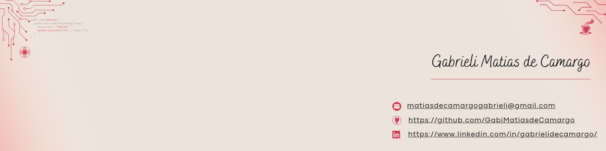
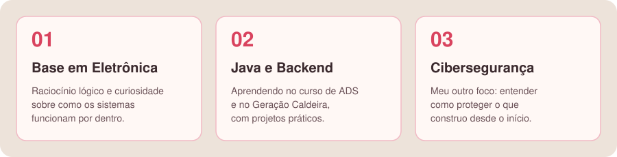
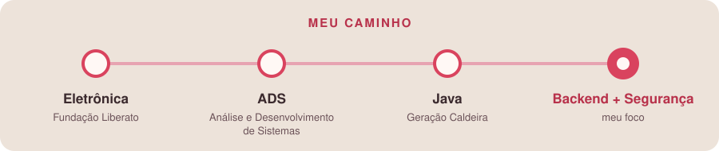

  

✦ ✦ ✦

## ✨ helloWorld_

  Oi, eu sou a <b>Gabrieli</b>! 🌸 
  Sou estudante de <b>Análise e Desenvolvimento de Sistemas</b> 
  e estou aprendendo <b>programação em Java</b> no <b>Geração Caldeira</b>.

  Antes da programação, me formei em <b>Eletrônica</b> pela <b>Fundação Liberato</b>. 
  Foi lá que desenvolvi o raciocínio lógico e a curiosidade de entender 
  <b>como as coisas funcionam por dentro</b>. 
  Hoje levo essa curiosidade para o código, com foco em <b>backend</b> e <b>cibersegurança</b>.

  Estou no começo da jornada e não escondo isso: 
  <b>este GitHub é o lugar onde organizo o que aprendo</b>, 
  com projetos, exercícios e experimentos.

 

<i>“Quero construir software que funciona, que é seguro e que outra pessoa consegue entender.”</i>

  

<b>Por onde começar</b> 
<a href="#-próximos-passos">Próximos passos</a> · <a href="#-tecnologias">Tecnologias</a> · <a href="#-projetos">Projetos</a> · <a href="#-vamos-conversar">Contato</a>

  

✦ ✦ ✦

## 🧭 Próximos passos

  

<table>
  <tr>
    <td align="center" width="25%" valign="top">
      <h3>01</h3>
      <b>Java e lógica de programação</b>  
      
    </td>
    <td align="center" width="25%" valign="top">
      <h3>02</h3>
      <b>Programação orientada a objetos</b>  
      
    </td>
    <td align="center" width="25%" valign="top">
      <h3>03</h3>
      <b>Backend: APIs e bancos de dados</b>  
      
    </td>
    <td align="center" width="25%" valign="top">
      <h3>04</h3>
      <b>Segurança de aplicações</b>  
      
    </td>
  </tr>
</table>

As etapas 1, 2 e 3 estão em andamento. Esta lista muda conforme eu aprendo.

  

✦ ✦ ✦

## 🌷 Tecnologias

 

Novas tecnologias entram aqui conforme eu avanço nos estudos.

  

✦ ✦ ✦

## 💻 Projetos

  Prefiro mostrar poucos projetos com uma finalidade clara a uma parede de logos. 
  Alguns são exercícios de estudo, e isso está indicado em cada descrição.

<table align="center">
  <tr>
    <th align="left">📁 Projeto</th>
    <th align="left">💡 Por que vale conhecer</th>
  </tr>
  <tr>
    <td><a href="https://github.com/GabiMatiasdeCamargo/GC-2026-Gabrieli_Matias_de_Camargo"><b>Geração Caldeira 2026</b></a> Java</td>
    <td>Registro da minha jornada no curso de Java: exercícios de aula e projetos práticos, como o de programação orientada a objetos inspirado em Stardew Valley.</td>
  </tr>
  <tr>
    <td><a href="https://github.com/GabiMatiasdeCamargo/Projetos_pessoais-Gabrieli-Matias-de-Camargo"><b>Projetos pessoais</b></a> Java · Python · JavaScript</td>
    <td>Projetos que faço por conta própria, fora do curso, para praticar, testar ideias e aprender novas linguagens. Ainda em construção.</td>
  </tr>
</table>

  <a href="https://github.com/GabiMatiasdeCamargo?tab=repositories"><b>Ver todos os repositórios →</b></a>

✦ ✦ ✦

## 🤝 Vamos conversar?

  Estou aberta a <b>estágio</b>, <b>trocas de conhecimento</b> 
  e <b>projetos em colaboração</b>, principalmente em backend e cibersegurança.

  
  

  Se algum repositório te ajudou, deixe uma ⭐

